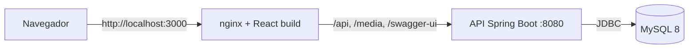
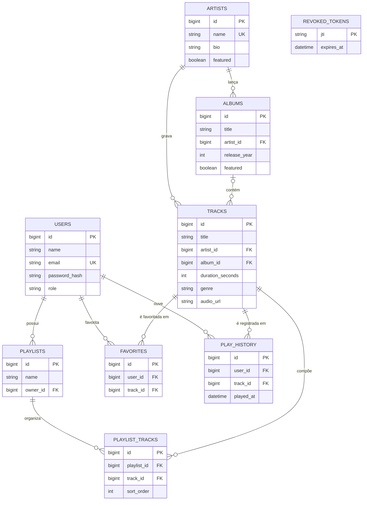

# Soundify

Plataforma de streaming de música com cadastro de usuários, catálogo, busca, player de áudio, playlists, favoritos e histórico de reprodução. Projeto de portfólio com **backend em Java/Spring Boot**, **frontend em React + TypeScript** e **banco MySQL**, tudo executável com um único `docker compose up`.

A identidade visual é própria (tema escuro em preto e cinza com destaque verde-jade, logotipo em barras de equalizador) e não usa marcas nem elementos do Spotify.

> **Sobre o conteúdo:** artistas, álbuns e músicas são **fictícios**. Os 19 áudios de demonstração (de 16 a 21 segundos) foram **sintetizados por código** (`tools/generate_demo_media.py`), portanto não têm direitos autorais de terceiros. Nenhum dado de popularidade ou número de reproduções é inventado: a seleção de "destaques" é uma curadoria fixa de demonstração e a interface avisa isso.

## Funcionalidades

- **Contas e segurança:** cadastro, login, perfil (nome e e-mail), logout com revogação do token. Senhas com hash BCrypt; autenticação por JWT; endpoints privados protegidos.
- **Catálogo:** músicas (paginadas), artistas, álbuns, gêneros; busca por título; busca global de músicas, artistas e álbuns; faixas de um álbum e de um artista.
- **Player:** tocar/pausar, anterior/próxima, barra de progresso com busca por posição, volume (lembrado entre sessões), tempo atual e total, capa/título/artista, reprodução contínua da fila, tratamento de erro de carregamento com "tentar de novo".
- **Playlists:** criar, editar nome/descrição, excluir, adicionar/remover músicas, reordenar, quantidade de músicas e duração total. Cada playlist só é acessível pelo dono (403 para outros usuários).
- **Favoritos:** favoritar/desfavoritar com atualização imediata na interface e listagem paginada.
- **Histórico:** registra só reproduções que realmente começaram (regra explicada abaixo).
- **Início:** adicionadas recentemente, tocadas recentemente, artistas e álbuns em destaque, playlists do usuário, acesso rápido às favoritas e busca global na barra superior.
- **Documentação da API:** Swagger UI em `/swagger-ui.html`.

## Tecnologias

| Camada | Tecnologias |
| --- | --- |
| Backend | Java 17, Spring Boot 3.5, Spring Web, Spring Data JPA (Hibernate), Spring Security, JWT (jjwt), Bean Validation, Flyway, springdoc-openapi (Swagger), Maven |
| Banco de dados | MySQL 8 (migrations versionadas com Flyway) |
| Testes | JUnit 5, Mockito, AssertJ |
| Frontend | React 19, TypeScript, Vite, React Router, Axios, CSS puro responsivo |
| Infraestrutura | Docker, Docker Compose, nginx |

## Arquitetura



Em produção local (Docker) o nginx serve a interface e encaminha `/api`, `/media` e a documentação para o backend, então o navegador fala com uma única origem. Em desenvolvimento, o servidor do Vite faz o mesmo papel (proxy). O backend segue camadas clássicas: `controller` → `service` → `repository` → `entity`, com `dto` e `mapper` na fronteira da API.

## Estrutura do repositório

```text
soundify/
├── backend/                      API REST (Spring Boot)
│   ├── src/main/java/br/com/soundify/
│   │   ├── config/               propriedades, segurança (Spring Security + CORS) e OpenAPI
│   │   ├── controller/           endpoints REST
│   │   ├── dto/                  objetos de entrada e saída (records)
│   │   ├── entity/               entidades JPA
│   │   ├── exception/            exceções de negócio e tratamento global de erros
│   │   ├── mapper/               entidade → DTO
│   │   ├── repository/           Spring Data JPA
│   │   ├── security/             JWT, filtro de autenticação e UserDetails
│   │   ├── service/              regras de negócio
│   │   └── util/
│   ├── src/main/resources/
│   │   ├── db/migration/         V1 (esquema) e V2 (dados de demonstração)
│   │   └── static/media/         áudios MP3, capas e imagens de artistas
│   ├── src/test/                 testes unitários (JUnit 5 + Mockito)
│   ├── Dockerfile
│   └── pom.xml
├── frontend/                     SPA React + TypeScript + Vite
│   └── src/                      components, contexts, hooks, pages, services, styles, types, utils
├── tools/generate_demo_media.py  gera áudios, capas e o seed SQL de demonstração
├── docker-compose.yml
└── .env.example
```

## Como executar

### Opção 1: Docker (recomendada)

Requisitos: Docker com Docker Compose.

```bash
cp .env.example .env      # no Windows (PowerShell): copy .env.example .env
# edite o .env e troque as senhas e o JWT_SECRET
docker compose up --build
```

A primeira execução baixa as imagens e compila tudo (alguns minutos). Depois:

| Serviço | Endereço |
| --- | --- |
| Aplicação | http://localhost:3000 |
| Swagger UI | http://localhost:8080/swagger-ui.html |
| Health check | http://localhost:8080/actuator/health |
| MySQL | `localhost:3306` (útil para o MySQL Workbench) |

Abra a aplicação, clique em **Cadastre-se** e crie uma conta. O catálogo de demonstração já vem carregado pelo Flyway na primeira subida. Para parar: `Ctrl+C` (ou `docker compose down`). Para apagar também o banco: `docker compose down -v`.

### Opção 2: desenvolvimento local (sem containerizar a API e o frontend)

Requisitos: JDK 17+, Maven 3.9+, Node 20+ e um MySQL 8 (pode ser o do Compose).

```bash
cp .env.example .env
docker compose up -d mysql            # ou use um MySQL instalado na sua máquina

# terminal 1: API em http://localhost:8080
cd backend
mvn spring-boot:run

# terminal 2: interface em http://localhost:5173
cd frontend
npm install
npm run dev
```

O backend lê automaticamente o `.env` da raiz do repositório (rodando de `backend/` ou da raiz), então não é preciso exportar variáveis. Na IDE (IntelliJ, VS Code, NetBeans), abra a pasta `backend` como projeto Maven e execute `SoundifyApplication`; confira se o diretório de trabalho é `backend` ou a raiz do repositório.

### Testes

```bash
cd backend
mvn test
```

Os testes cobrem as regras de negócio com Mockito: cadastro e login, geração e validação do JWT, regras de playlist (posse, duplicidade, ordem), histórico (mínimo de reprodução e deduplicação), favoritos e normalização das buscas. No frontend, `npm run typecheck` executa o TypeScript em modo estrito.

## Variáveis de ambiente

| Variável | Para que serve | Padrão |
| --- | --- | --- |
| `MYSQL_DATABASE`, `MYSQL_USER`, `MYSQL_PASSWORD`, `MYSQL_ROOT_PASSWORD` | Banco de dados | sem padrão (obrigatórias no Docker) |
| `JWT_SECRET` | Segredo de assinatura dos tokens (mínimo 32 caracteres; a API não inicia sem ele) | sem padrão |
| `JWT_EXPIRATION_MINUTES` | Validade do token | `120` |
| `CORS_ALLOWED_ORIGINS` | Origens do frontend aceitas pela API | `http://localhost:3000,http://localhost:5173` |
| `BACKEND_PORT`, `FRONTEND_PORT`, `MYSQL_PORT` | Portas expostas no host | `8080`, `3000`, `3306` |
| `DB_HOST`, `DB_PORT` | Endereço do MySQL ao rodar o backend fora do Docker | `localhost`, `3306` |

O `.env` está no `.gitignore`; só o `.env.example` é versionado.

## API

Base: `/api`. Respostas de erro seguem sempre o mesmo formato (`timestamp`, `status`, `error`, `message`, `path` e, em validações, `fieldErrors`). Listas paginadas devolvem `content`, `page`, `size`, `totalElements`, `totalPages`, `first` e `last`.

| Método e caminho | Acesso | Descrição |
| --- | --- | --- |
| `POST /auth/register` | público | Cria conta e devolve o token |
| `POST /auth/login` | público | Login com e-mail e senha |
| `POST /auth/logout` | autenticado | Revoga o token atual |
| `GET /users/me` · `PUT /users/me` | autenticado | Consulta e atualiza nome e e-mail |
| `GET /tracks` | público | Músicas paginadas: `q` (título), `genre`, `sort` (`recent` ou `title`), `page`, `size` |
| `GET /tracks/recent` · `GET /tracks/{id}` | público | Adicionadas recentemente; música por ID |
| `GET /genres` | público | Gêneros disponíveis |
| `GET /artists` · `/artists/featured` · `/artists/{id}` | público | Lista/busca, destaques e detalhe |
| `GET /artists/{id}/tracks` · `/artists/{id}/albums` | público | Músicas e álbuns do artista |
| `GET /albums` · `/albums/featured` · `/albums/{id}` | público | Lista/busca, destaques e detalhe |
| `GET /albums/{id}/tracks` | público | Faixas do álbum, na ordem do disco |
| `GET /search?q=&limit=` | público | Busca global (músicas, artistas e álbuns) |
| `GET /playlists` · `POST /playlists` | autenticado | Lista (com contagem e duração) e cria |
| `GET /playlists/{id}` · `PUT` · `DELETE` | autenticado, só o dono | Detalhe, edição e exclusão |
| `POST /playlists/{id}/tracks` | autenticado, só o dono | Adiciona música (`{"trackId": 1}`) |
| `DELETE /playlists/{id}/tracks/{trackId}` | autenticado, só o dono | Remove música |
| `PUT /playlists/{id}/tracks/order` | autenticado, só o dono | Reordena (`{"trackIds": [3, 1, 2]}`) |
| `GET /favorites` · `GET /favorites/ids` | autenticado | Favoritas paginadas; só os IDs |
| `PUT /favorites/{trackId}` · `DELETE /favorites/{trackId}` | autenticado | Favorita e desfavorita (idempotentes) |
| `POST /history` · `GET /history` | autenticado | Registra uma reprodução; últimas reproduções |

Os áudios e as capas são arquivos estáticos em `/media/**` (público, para o elemento `<audio>` poder carregá-los), com suporte a `Range`, o que permite pular para qualquer ponto da música.

Para testar pelo Swagger: use `POST /api/auth/login`, copie o `token` da resposta, clique em **Authorize** e cole o valor.

## Modelo de dados



Restrições de integridade: chaves estrangeiras, e-mail único, par (playlist, música) único, par (usuário, música) único nos favoritos, `CHECK` de duração positiva e `ON DELETE CASCADE` nos itens que dependem de playlist, usuário ou música.

## Decisões técnicas

- **Senhas e tokens.** Senhas só existem como hash BCrypt. O JWT (HMAC-SHA, validade configurável) carrega apenas o ID do usuário, o papel e um `jti`; nada sensível. Tokens e senhas nunca são escritos em log. O segredo vem do ambiente e a API se recusa a iniciar com um segredo curto.
- **Logout de verdade.** Como JWT é stateless, o logout grava o `jti` do token em `revoked_tokens` e o filtro de autenticação recusa tokens revogados; uma rotina agendada apaga os registros que já expirariam sozinhos. No frontend, qualquer `401` fora do login derruba a sessão local.
- **Mesma mensagem para e-mail inexistente e senha errada**, para não revelar quais e-mails têm conta.
- **Catálogo público, dados do usuário privados.** Leitura do catálogo não exige login (facilita explorar o Swagger); playlists, favoritos, histórico e perfil exigem token. Playlists são privadas: outra pessoa recebe `403`.
- **Histórico sem registros falsos.** O player só avisa a API depois que a música *realmente tocou* por 3 segundos acumulados (pular na barra não conta, clique que não chegou a tocar nem erro de carregamento também não). A API confere de novo (`422` abaixo do mínimo) e ignora o mesmo registro repetido dentro de uma janela curta.
- **Esquema versionado.** O banco é criado por migrations Flyway (`V1` esquema, `V2` dados de demonstração) e o Hibernate roda com `ddl-auto: none`.
- **Consultas sem N+1.** Listagens usam `join fetch` e `@EntityGraph`; `open-in-view` está desligado, então o mapeamento para DTO acontece dentro da transação.
- **Erros padronizados** em um único `@RestControllerAdvice`, inclusive os do próprio Spring MVC.
- **Frontend.** Estado global em Context API (autenticação, player, favoritos, playlists); o tempo de reprodução fica em um contexto separado para as listas não re-renderizarem 4 vezes por segundo. Um único elemento `Audio` serve o app inteiro e é descartado no logout. Favoritar atualiza a tela na hora e desfaz se a API falhar.
- **Visual.** Interface escura e quieta; a cor da página vem da capa do álbum desfocada atrás do cabeçalho. Respeita `prefers-reduced-motion`, tem foco visível e funciona em telas pequenas.

## Mídia de demonstração

`tools/generate_demo_media.py` gera, sem depender de nenhum arquivo externo, os MP3 (síntese aditiva, bateria por ruído, estilos de synthwave a ambient), as capas e imagens de artista em SVG e o script `V2__seed_demo_data.sql`, garantindo que a duração cadastrada no banco seja igual à do arquivo. Os arquivos gerados já estão no repositório; o script só é necessário para alterar o catálogo de demonstração (requer Python, `numpy` e `ffmpeg`). Se regerar o `V2__seed_demo_data.sql`, recrie o banco com `docker compose down -v`, porque o Flyway confere o checksum das migrations já aplicadas.

## Limitações e próximos passos

- Limitar tentativas de login (rate limiting) e usar *refresh token* em cookie `httpOnly` em vez de `localStorage`.
- Cache para a checagem de tokens revogados (hoje há uma consulta por requisição autenticada).
- Testes de integração com Testcontainers e pipeline de CI.
- Upload de músicas, playlists públicas/compartilháveis, modo aleatório e repetição no player.
- Migrar para o Spring Boot 4.x.

## Publicar no GitHub

```bash
git init
git add .
git commit -m "feat: Soundify, plataforma de streaming de música"
git branch -M main
git remote add origin https://github.com/<seu-usuario>/soundify.git
git push -u origin main
```

O envio de arquivos pelo navegador do GitHub aceita no máximo 100 arquivos por vez e este projeto tem mais que isso; prefira o Git ou o GitHub Desktop. Confira que o `.env` **não** foi adicionado (só o `.env.example`).

## Licença

Distribuído sob a licença MIT. Veja o arquivo [LICENSE](LICENSE).
